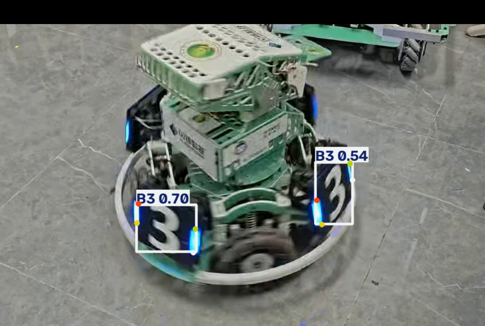

# yolo-armor-inference


猎隼的作业


## 1. 项目完成的功能

本项目基于 YOLO26n 装甲板模型（`best.pt`），编写了 Python 推理脚本 `infer.py`。具体功能包括：

*   加载模型权重，读取自己拍摄的视频文件。

*   对视频逐帧执行推理。

*   在检测到目标时，显示检测框、类别、置信度，以及该目标的 4 个关键点。

*   保存与原视频内容对应、能够正常播放的推理结果视频。


## 2. 运行环境与硬件

*   **Python版本**：Python 3.12.x

*   **主要依赖**：`ultralytics`、`opencv-python`（具体版本见 `requirements.txt`）。

*   **硬件**：本次作业使用 **CPU** 运行（若环境有 NVIDIA 显卡并安装 CUDA，代码会自动切换为 GPU）。


## 3. 模型权重的准备与放置

*   **准备方式**：模型权重 `best.pt` 需从课程参考材料中获取。

*   **放置位置**：请在项目根目录下新建 `weights` 文件夹，将 `best.pt` 放置在 `weights/` 目录下，即 `weights/best.pt`。


## 4. 依赖安装、运行命令与结果说明

**依赖安装步骤：**

```bash

pip install -r requirements.txt -i https://pypi.tuna.tsinghua.edu.cn/simple
```


**实际运行命令：**

```bash

# 默认使用默认路径

py -3.12 infer.py


# 或者通过命令行参数指定路径（模型路径、视频路径、输出位置均可自定义）

py -3.12 infer.py --model weights/best.pt --source videos/test.mp4 --output output/result.avi

## 5. 视频拍摄说明

*   **拍摄地点**：水建学院D414实验室。

*   **视频时长**：约 11 秒。

*   **场景说明**：视频拍摄了机器人的装甲板，画面包含了多个角度的装甲板目标，用于验证模型在真实场景下的检测和关键点回归能力。


## 6. 结果展示



*图注：检测到装甲板，显示类别 B3，置信度 0.70 / 0.54，且红色、黄色、蓝色、绿色4个关键点清晰标出。\*


## 7. 实际识别表现、遇到的问题及处理方法

*   **识别表现**：模型在大部分画面中能成功检测到装甲板并正确回归出4个关键点，检测框和关键点颜色对应良好。

*   **遇到的问题与处理方法**：

1.  **漏检/误检现象**：在视频某些帧中，由于运动模糊或光线变化，出现了短暂的目标漏检，以及置信度较低的误检（如截图中的 0.54）。这属于模型在真实场景下的正常表现，已如实保留结果并记录。

2.  **OpenCV视频编码兼容性问题**：最初使用 `mp4v` 编码器时，Windows下生成的 `mp4` 视频无法正常播放。**处理方法**：将代码中的编码器改为 `XVID`，输出后缀改为 `.avi`，成功生成了能正常播放的 `result.avi`。

3.  **全片无有效检测的排查过程**：如果全片没有有效检测，应依次检查权重文件是否正确加载、视频输入是否正常读取、推理参数是否设置过严。本次作业通过增加 `\[DEBUG]` 打印信息，成功排查了初始路径不对导致的问题。


## 8. 模型格式转换

本项目已完成 YOLO 模型的格式转换，将原始的 `best.pt` 转换为了以下两种格式：

*   **ONNX (`best.onnx`)**：通用模型交换格式，适用于跨平台部署。

*   **TorchScript (`best.torchscript`)**：PyTorch 官方提供的模型部署格式。


**转换命令**：

```bash

py -3.12 export*_model.py

```
